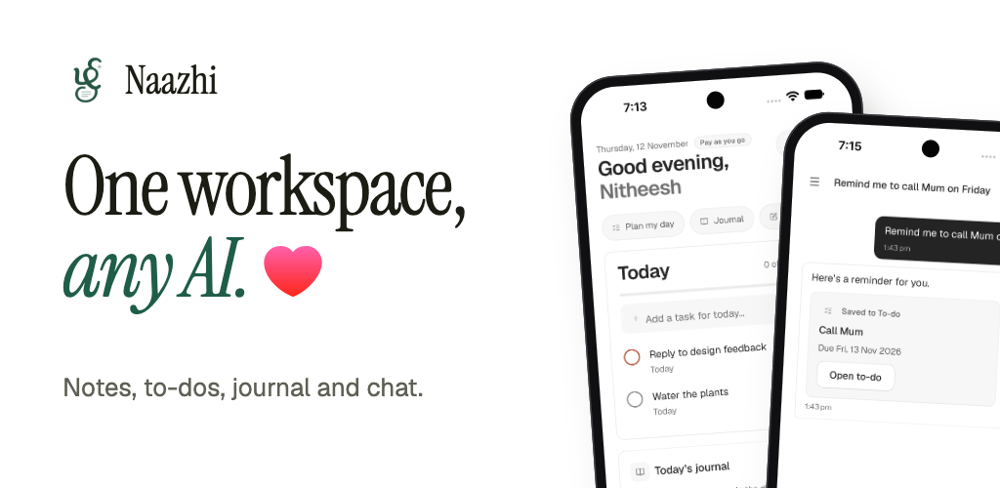

<p align="center">
  
</p>

# Naazhi

Naazhi is a SaaS workspace for **notes, tasks, journal, chat, calendar, email, meetings and automations** — with an AI layer you can swap, bring your own account to, or switch off entirely. It runs as a hosted service on the web and as an iOS and Android app.

- Web app and website: https://dashboard.naazhi.app
- Mobile: Expo / React Native, same account and data as the web app

> **Working on this project?** Read [`AGENTS.md`](AGENTS.md) (rules for humans _and_ AI agents), then [`docs/ONBOARDING.md`](docs/ONBOARDING.md). Plan and tasks live in Jira: https://setups-works.atlassian.net/jira/software/projects/UNT/boards

## What's in the product

- **Journal** — many timestamped entries per day, calendar, voice, attachments, and shared journals you write together with other people.
- **Notes** — colour cards, editor, slash commands, voice, attachments and history.
- **To-do** — lists, priorities, repeat, Inbox / Today / Upcoming / Filters, board and calendar layouts.
- **Chat** — folders, pin, unread and share links, with AI replies that can save things straight to your To-do.
- **Search** — universal search with Ctrl/⌘+K.
- **Accounts and plans** — email + password, Google sign-in, passkeys, and pay-as-you-go billing.
- **Admin panel** — users, usage, announcements and an audit log.
- **Marketing site** — home, how it works, pricing, privacy & security, feature pages and a changelog.

What's planned is in [`docs/PHASES.md`](docs/PHASES.md) and the Jira board.

## Repository layout

A pnpm/Turborepo monorepo:

```
apps/web/             Next.js 16 app: marketing site, signed-in workspace, admin panel, API
apps/mobile/          Expo Router / React Native app
packages/api-client/  Shared API transport for web and mobile
db/migrations/        SQL migrations (append-only)
docs/                 Architecture, phases, workflow, data model, security, Jira guide
```

The backend uses PostgreSQL, Better Auth, S3-compatible object storage and Redis. Every folder has an `AGENTS.md` explaining its purpose and rules; [`docs/CURRENT_STATE.md`](docs/CURRENT_STATE.md) maps what is where.

## Local development

Requires **Node.js 22.13+**, Corepack/pnpm and Docker (Docker is only used to run the local database, cache, storage and mail catcher).

```bash
corepack pnpm install
cp .env.selfhost.example .env.selfhost     # local service passwords (openssl rand -hex 16)
cp .env.example apps/web/.env.local        # app settings
corepack pnpm docker:up                    # PostgreSQL, Redis, storage, Mailpit
corepack pnpm db:migrate                   # create the tables
corepack pnpm dev:web                      # http://localhost:3000 (emails: http://localhost:8025)
```

For Expo, set `EXPO_PUBLIC_API_URL` in `apps/mobile/.env.local` (Android emulator: `http://10.0.2.2:3000`; iOS simulator: `http://localhost:3000`; physical devices: your computer's LAN address), then run `corepack pnpm dev:mobile`. `corepack pnpm dev` starts both apps.

| Command                    | Purpose                                   |
| -------------------------- | ----------------------------------------- |
| `corepack pnpm dev`        | Start web and Expo development servers    |
| `corepack pnpm dev:web`    | Start Next.js at localhost:3000           |
| `corepack pnpm dev:mobile` | Start the Expo development server         |
| `corepack pnpm docker:up`  | Start the local data services             |
| `corepack pnpm db:migrate` | Apply SQL migrations from `db/migrations` |
| `corepack pnpm typecheck`  | Typecheck every workspace                 |
| `corepack pnpm build`      | Build web and mobile apps                 |

> Don't run `corepack pnpm build:web` while the web dev server is running; both write to `apps/web/.next`.

### Environment variables

See [`.env.example`](.env.example). Never commit `.env*` files; never prefix a secret with `NEXT_PUBLIC_`.

| Variable                                                               | Needed for                                              |
| ---------------------------------------------------------------------- | ------------------------------------------------------- |
| `DATABASE_URL`, `BETTER_AUTH_SECRET`, `BETTER_AUTH_URL`                | Everything signed-in                                    |
| `REDIS_URL`                                                            | Cache and rate limits (optional; the app runs without)  |
| `S3_ENDPOINT`, `S3_ACCESS_KEY`, `S3_SECRET_KEY`                        | Avatars, note/journal/chat attachments                  |
| `SMTP_URL`, `MAIL_FROM`                                                | Verification, password reset and invitation emails      |
| `GOOGLE_CLIENT_ID`, `GOOGLE_CLIENT_SECRET`                             | Optional "Continue with Google"                         |
| `ADMIN_EMAILS`                                                         | Comma-separated emails that are always admins           |
| `GROQ_API_KEY`, `COMPOSIO_API_KEY`, `CRON_SECRET`, Sentry/PostHog keys | AI, integrations, scheduled jobs and monitoring         |

## Documentation

[`docs/README.md`](docs/README.md) is the index: onboarding, architecture, phases, team workflow, current state, data model, security, conventions, Jira guide and the full backlog.

## Design system

Tokens are at the top of `apps/web/src/app/globals.css`; the rules are in [`docs/DESIGN_LANGUAGE.md`](docs/DESIGN_LANGUAGE.md) and the brand in [`docs/BRAND.md`](docs/BRAND.md).

## Deployment

Naazhi is deployed to Azure as a container by GitHub Actions (`.github/workflows/deploy-azure-docker.yml`). Releases follow [`docs/RELEASE_FOR_AGENTS.md`](docs/RELEASE_FOR_AGENTS.md): apply migrations first, then ship the app.

## Logos & trademarks

Files in `apps/web/public/logos/` belong to their respective owners and are shown only to indicate supported integrations. Icons elsewhere are [Font Awesome Free](https://fontawesome.com) (solid).

---

Backed by **Setups Works** (செட்டப்ஸ் வொர்க்ஸ்).
