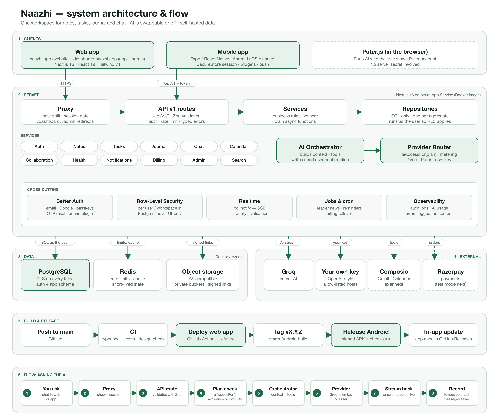

# Architecture

The target system, how code is layered, and the rules that keep three developers' work compatible.

## 1. System overview



_Source: [architecture.svg](architecture.svg) (vector). Update the image when the structure changes._

In words, top to bottom:

- **Clients.** The website (`naazhi.app`) and the signed-in app plus admin (`dashboard.naazhi.app`) are one Next.js app that the proxy serves by host. The Expo / React Native app (Android today, iOS planned) calls the same `/api/v1/*` routes through `packages/api-client`. Puter.js runs in the browser with the user's own Puter account.
- **Server** (Next.js 16 on Azure App Service, deployed as a Docker image): proxy (host split and session gate) → API v1 routes (Zod, auth, rate limit) → services → repositories → PostgreSQL.
- **Services today:** auth and account, notes, tasks, journal, chat and AI, calendar, shared journals (collaboration), health, notifications, Reader (RSS), billing and plans, admin. Email, meetings and automations are not built (`FEATURES` flags are off); Composio is planned.
- **Data:** PostgreSQL 16 (RLS on every table, Better Auth tables in the `auth` schema), Redis, and object storage (S3-compatible, Cloudflare R2, or Azure Blob). All files are private and served through our own routes.
- **External:** Groq (server AI), the user's own key (OpenAI-compatible, fixed list of hosts), Firebase for Android push, and a payment provider that is **not connected yet** (`FEATURES.payments` is off: plan changes are recorded, nobody is charged).
- **Build and release:** push to `main` → CI → "Deploy web app to Azure". A `vX.Y.Z` tag → "Release Android" → signed APK on GitHub Releases → the app's updater. See `docs/RELEASE_FOR_AGENTS.md`.
- **Observability:** audit logs (`admin_audit`), AI token counts (`ai_usage`), and errors logged without message content.

## 2. Layers and the one rule that matters

```
UI component  →  feature hook  →  API v1 route / server action  →  service  →  repository  →  PostgreSQL
(apps/web/src/components, (apps/web/src/features)    (apps/web/src/app/api/v1)                (apps/web/src/server/   (apps/web/src/server/
 apps/web/src/features)                                                      services)      repositories)
```

A layer may only import from the layer to its right. Concretely:

| Layer                          | May import                                                | Must not                                          |
| ------------------------------ | --------------------------------------------------------- | ------------------------------------------------- |
| Components / features (client) | hooks, `apps/web/src/lib`, `apps/web/src/types`, `apps/web/src/config` (public part) | `apps/web/src/server/**`, secrets, the database owner role |
| API routes / server actions    | services, `apps/web/src/lib`, zod schemas                          | repositories directly, UI                         |
| Services                       | repositories, providers, other services, `apps/web/src/config`     | `next/*` UI APIs, React                           |
| Repositories                   | `apps/web/src/server/db`, `apps/web/src/types`                              | business rules, other services                    |
| Providers (AI)                 | `apps/web/src/config`, SDK                                         | feature services                                  |

Why: services are reused by the UI (through routes), background jobs, automations and **AI tools**. If rules live in a component, the AI can't use them safely.

## 3. Runtime boundaries

| Where it runs                                       | What                                                                     | Secrets?                   |
| --------------------------------------------------- | ------------------------------------------------------------------------ | -------------------------- |
| Browser                                             | React UI, the `/api/v1/db` client (RLS-protected reads/writes), Puter.js | None. Only `NEXT_PUBLIC_*` |
| Azure App Service (route handlers, server actions, RSC) | Services, repositories, Groq calls, billing, uploads                  | Yes — via `serverEnv()`    |
| iOS / Android                                        | Expo app, Better Auth Expo client, shared API transport                   | None; session token in SecureStore |
| GitHub Actions schedule → `/api/cron/*`             | Hourly jobs such as Reader news notifications (`cron-notifications.yml`) | `CRON_SECRET` bearer token |
| Self-hosted Docker services                         | Postgres (RLS, triggers), Better Auth, S3 storage, Redis, realtime       | Docker                     |

**Browser → `/api/v1/db`** (validated, allow-listed, run as the user so RLS applies) is allowed for simple, RLS-covered CRUD (current notes/tasks/journal/chat code does this). It is **not** allowed for anything with business rules, side effects, third-party calls, or multi-table atomicity — those go through a service. Phase 1 migrates notes as the reference and the rest follow.

## 4. Multi-tenancy (Phase 1)

- `workspaces`, `workspace_members(role)`; every user gets a personal workspace.
- Domain tables get `workspace_id`; RLS uses `is_workspace_member(workspace_id)`.
- Private-by-author data (journal entries, chats unless shared) additionally checks `user_id = auth.uid()`.
- The active workspace is a cookie resolved once per request by the API helper.

## 5. API v1

`apps/web/src/app/api/v1/<resource>/route.ts`, built with the shared `handler({ auth, schema, rateLimit })` helper (Phase 1): Zod validation, uniform error JSON `{ error: { code, message } }`, cursor pagination, rate limiting. Server actions are fine for form-style UI mutations but call the same services.

## 6. AI architecture

```
Chat UI ──► POST /api/v1/ai/chat ──► AI Orchestrator ──► Provider Router ──► Groq (server stream)
                                          │                         └────► Puter.js (browser runtime)
                                          ├─ builds context (conversation window, workspace data)
                                          ├─ tool calls ──► Composio / our services (writes need user confirmation)
                                          ├─ stores messages + usage (ai_usage)
                                          └─ "No AI" mode when no provider is available
```

- Providers implement `AiProvider` (`apps/web/src/server/providers/ai/types.ts`): `id`, `runtime` (`server`|`client`), `isAvailable()`, `stream()`.
- Puter runs in the browser; the orchestrator hands the prompt to the client, which streams the answer and posts the final message back so storage is identical.
- **Plans gate every AI call:** `aiAccessFor(userId)` runs first (subscription allowance, pay as you go, or bring your own key) and `record()` counts tokens afterwards. Saved keys are sealed with AES-256-GCM. See `docs/BILLING.md`.
- Tool output and user content are **untrusted**; prompts are versioned files in `apps/web/src/server/services/ai/prompts`.

## 7. Integrations (Composio)

Browser → our `/api/v1/integrations/*` → `apps/web/src/server/services/composio` → Composio. We store only Composio connection ids and a display label — never OAuth tokens. Triggers (new mail, calendar change) arrive at a webhook route, are verified, and become job/automation events.

## 8. Realtime, search, jobs

- **Realtime:** Postgres `pg_notify` triggers → Server-Sent Events (`/api/v1/realtime`) → TanStack Query invalidation.
- **Search:** Postgres full-text (tsvector + GIN) first; pgvector hybrid later.
- **Jobs:** a scheduled GitHub Actions workflow calls `/api/cron/*` with `CRON_SECRET`; billing periods settle lazily on read, so no cron is needed for them. A `jobs` table with locking and retries is planned for sync, transcription and automations.

## 9. Monorepo and source layout

| Path | What it is |
| --- | --- |
| `apps/web` | Next.js 16 app (website, signed-in app, admin, `/api/v1`) and its tests |
| `apps/mobile` | Expo Router app (Android today) |
| `packages/api-client` | Platform-independent HTTP transport used by web and mobile |
| `packages/types`, `packages/validation`, `packages/logic` | Shared types, Zod schemas, and pure logic (billing maths, widgets, updates) with tests |
| `db/migrations` | Append-only SQL migrations (applied manually in production) |
| `docker-compose.yml`, `Dockerfile` | Local stack and the production image |
| `.github/workflows` | CI, Azure deploy, Android release, scheduled jobs |

See `AGENTS.md` §3 and each folder's `AGENTS.md`. Routes today: `docs/CURRENT_STATE.md`.

## 10. Decisions log

Record architectural decisions here with date, decision, and reason. Open decisions are tagged `decision-needed` in Jira.

| Date    | Decision                                                                  | Why                                                                                    |
| ------- | ------------------------------------------------------------------------- | -------------------------------------------------------------------------------------- |
| 2026-10 | `apps/web/src/` layout and layered server code                                     | Parallel work for 3 developers + AI agents; services reusable by UI, jobs and AI tools |
| 2026-10 | Composio for OAuth/tools; we store connection ids only                    | Avoid handling third-party tokens                                                      |
| 2026-10 | Groq on the server, Puter.js in the browser behind one provider interface | Cheap fast default + bring-your-own-account option                                     |
| 2026-10 | Billing plans (subscription, pay as you go, bring your own key) with AI metered per user | One AI gate for every provider; payments can be added later without touching features |
| 2026-11 | Website and app served from separate hosts (`naazhi.app`, `dashboard.naazhi.app`), web deployed as a Docker image to Azure | Clean addresses, one codebase, simple self-hosting |
| _open_  | Final route structure (`(app)` group vs `/dashboard/*`)                   | Jira UNT-49                                                                            |
| _open_  | Embedding provider for semantic search                                    | Jira UNT-86                                                                            |
| _open_  | Transcription provider and email-sending provider                         | Jira UNT-88, UNT-91                                                                    |
